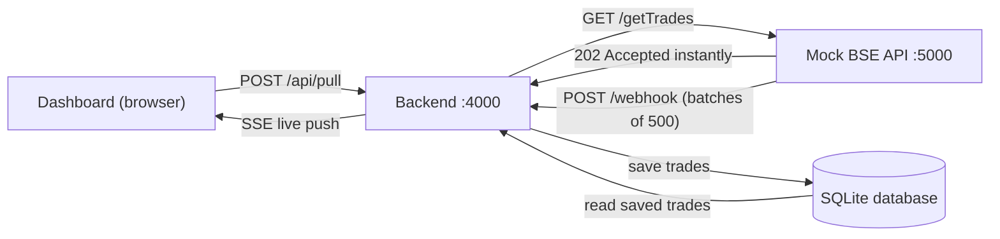

# Architecture Note

## Problem

A full BSE pull takes up to 15 minutes, but the network kills any HTTP connection open longer than 30 seconds. A single request that waits for the data can never work.

## Design: async job + webhook + server push

## Why this design

| Requirement | How it is met |

|---|---|

| 15-min pull vs 30-s connection limit | `/getTrades` returns `202` immediately. Data comes back later as short webhook calls, each under a second. |

| Dashboard opens instantly | It reads from our own SQLite database, never from BSE. |

| Shows trades even mid-pull | Batches are saved as they arrive, so the database always holds partial results. |

| Live updates, no refresh | Server-Sent Events push new rows to open dashboards. |

| No polling, no cron | A pull starts from a user action. Data is pushed by webhook and SSE, with no timers that check for work. |

## Key decisions

- **Webhook over long polling:** keeps every connection short.

- **SSE over WebSocket:** updates only flow server to browser, so SSE is simpler, and `EventSource` reconnects automatically.

- **Batches:** the mock sends 500 trades at a time, so data appears progressively.

- **Idempotent inserts:** `trade_id` is `UNIQUE` with `INSERT OR IGNORE`, so retried webhooks cannot create duplicates.

- **Reconnect safety:** every row has an increasing `seq`. After a dropped connection the dashboard calls `/api/trades?after=<lastSeq>` to catch up.

- **SSE and the 30-second rule:** the server sends a heartbeat every 15 s, and the browser reconnects within 2 s if the connection is cut.

## Trade-offs and limitations

- Pull status is held in memory, so it resets if the backend restarts. Trade data itself is persisted.

- A production version would add webhook authentication, retries with backoff, and a job table in the database.

